# GST-Invoice — Complete User Manual & Visual Operating Guide

Welcome to **GST-Invoice**, a modern, compliant GST accounting and invoicing platform designed for catering and hospitality operations. This manual provides detailed, visual step-by-step guidance for business owners, accountants, and administrative staff.

---

## Table of Contents

1. [System Architecture & Core Principles](#1-system-architecture--core-principles)
2. [Sign-In & User Roles](#2-sign-in--user-roles)
3. [Dashboard & Period Tracking](#3-dashboard--period-tracking)
4. [Settings & Business Masters](#4-settings--business-masters)
5. [Managing Parties (Customers & Suppliers)](#5-managing-parties-customers--suppliers)
6. [Sales Invoicing & Billing Workflow](#6-sales-invoicing--billing-workflow)
7. [Purchase Bills & Input Tax Credit (ITC)](#7-purchase-bills--input-tax-credit-itc)
8. [GST Returns & Period Closure (GSTR-1 & GSTR-3B)](#8-gst-returns--period-closure-gstr-1--gstr-3b)
9. [Document Attachments & Neon Object Storage](#9-document-attachments--neon-object-storage)
10. [Audit Trail & System Security](#10-audit-trail--system-security)
11. [Troubleshooting & Frequently Asked Questions (FAQ)](#11-troubleshooting--frequently-asked-questions-faq)

---

## 1. System Architecture & Core Principles

- **Integer Paise Arithmetic:** Every rupee amount is internally stored as integer paise (`₹1.00 = 100 paise`). Tax calculations use half-up rounding per line to prevent fractional rounding errors common in standard floating-point systems.
- **Server-Side Authoritative Engine:** Live calculation previews shown on screen are verified and recalculated on the server.
- **Plain, Fast UI:** Clean, responsive, high-contrast user interface with zero external CSS frameworks, optimizing load speed and data clarity.
- **Private S3-Compatible Storage:** Uploaded files (vendor bills, delivery challans, signed contracts) are stored in encrypted object storage and streamed only to authenticated users.

---

## 2. Sign-In & User Roles

### Login Screen
Navigate to `/login` to access the application.

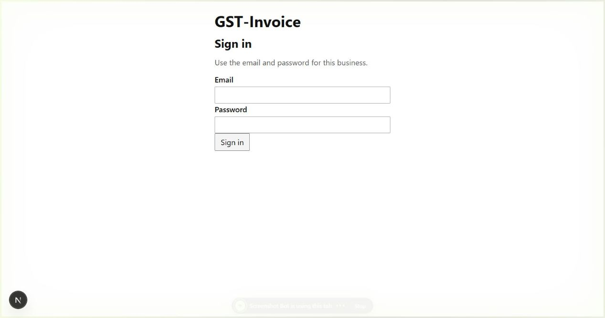

### What to Enter:
1. **Email:** Enter your assigned email address (Default Administrator: `login@genrecai.com`).
2. **Password:** Enter your account password (Default: `genrecai`).
3. Click the **Sign in** button.

### User Roles & Permissions:
- **Owner:** Full administrative authority. Can modify business GSTIN, alter tax rates, invite/deactivate staff, view the complete audit log, and unlock return periods.
- **Accountant:** Day-to-day transaction access. Can enter sales invoices, record purchase bills, manage customer/supplier parties, view returns, and download reports.

---

## 3. Dashboard & Period Tracking

After successful authentication, you arrive at the home dashboard (`/`).

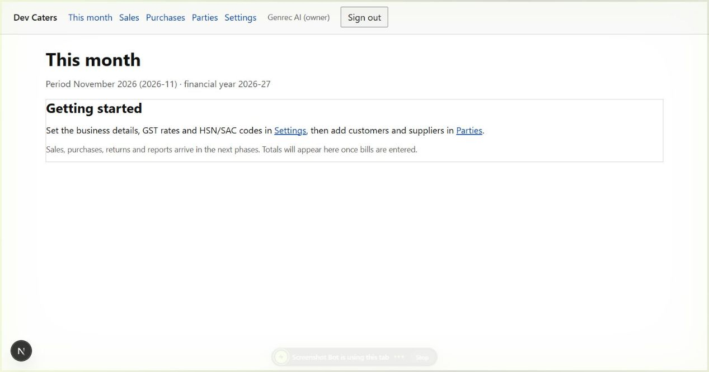

### Key Information Displayed:
- **Active Business:** Displays the registered trade name (e.g., *Dev Caters*).
- **Current Filing Period:** Shows the active return month (e.g., *November 2026 / 2026-11*) and active Financial Year (*2026-27*).
- **Navigation Bar:** Persistent links to **This month**, **Sales**, **Purchases**, **Parties**, **Settings**, and **Sign out**.
- **User Role Badge:** Highlights your signed-in name and role (`owner` or `accountant`).

---

## 4. Settings & Business Masters

Access **Settings** (`/settings`) from the top navigation to configure master settings.

### 4.1 Business & GST Profile
Configure registered tax details:

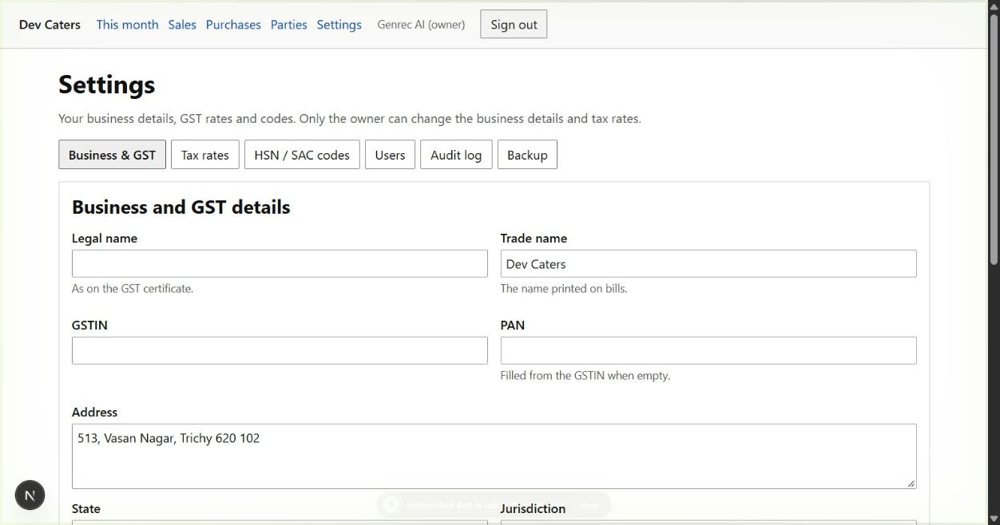

**Fields & Configuration:**
- **Legal Name & Trade Name:** Full registered company name and trading brand.
- **GSTIN & PAN:** 15-character GSTIN (e.g. `33AAAAA0000A1Z5`) and 10-character PAN.
- **Principal Address:** Registered address printed on invoice headers.
- **State:** Select the registered home state (e.g. `33 Tamil Nadu`).
- **Registration Type:** `Regular` (standard taxpayer) or `Composition`.
- **Filing Frequency:** `Monthly` or `Quarterly` (QRMP scheme).
- **Invoice Prefix:** Default prefix for new sales bills (e.g. `DC/`).

### 4.2 Tax Rates Configuration
Manage tax rates under the **Tax rates** tab:

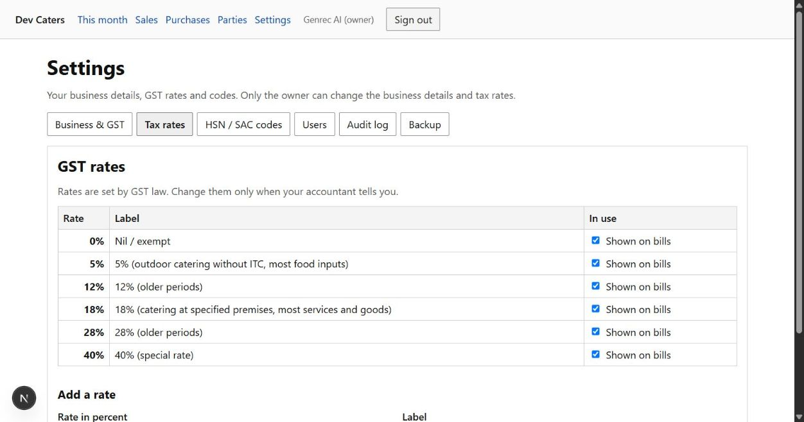

- Configured in basis points (`100 bp = 1%`).
- Standard rates include `0%` (Nil/Exempt), `5%` (Outdoor catering without ITC), `12%`, `18%` (Specified premises/catering with ITC), `28%`, and special rates.

### 4.3 HSN / SAC Codes
Under the **HSN / SAC codes** tab, maintain service and goods classifications:

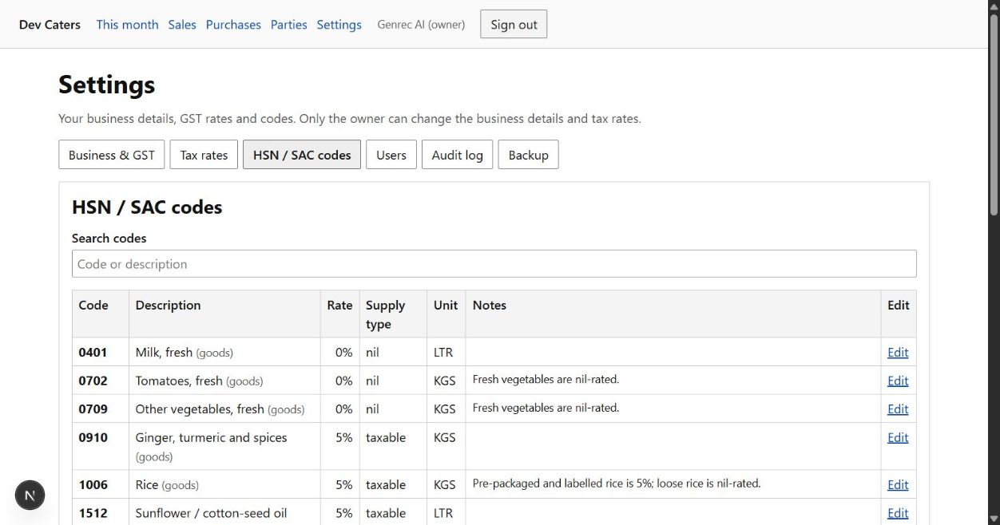

- **996331:** Services provided by restaurants, cafes, and outdoor catering.
- **996332:** Event catering at banquet halls, hotels, and exhibition centers.
- Default rates and ITC allowance flags are linked directly to each code.

---

## 5. Managing Parties (Customers & Suppliers)

Click **Parties** (`/parties`) to manage your client and vendor database.

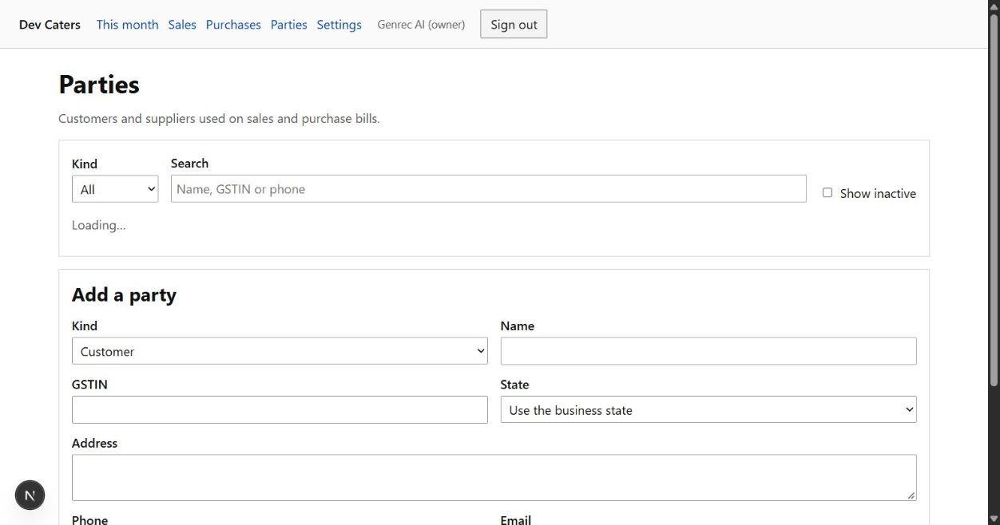

### Adding a New Party:
1. **Kind:** Select `Customer` for catering clients, or `Supplier` for food input vendors.
2. **Name:** Enter the legal name (e.g., *Apex Events Corp* or *Cauvery Spices & Provisions*).
3. **GSTIN:** Enter 15-character GSTIN. Leave blank for unregistered retail customers.
4. **State:** Choose state. Selecting *Use the business state* flags the party for intra-state (CGST + SGST) billing.
5. **Address, Phone, Email:** Contact and billing details.
6. Click **Add party**.

---

## 6. Sales Invoicing & Billing Workflow

### 6.1 Sales List Overview
Navigate to **Sales** (`/sales`) to view, filter, and manage all issued bills:

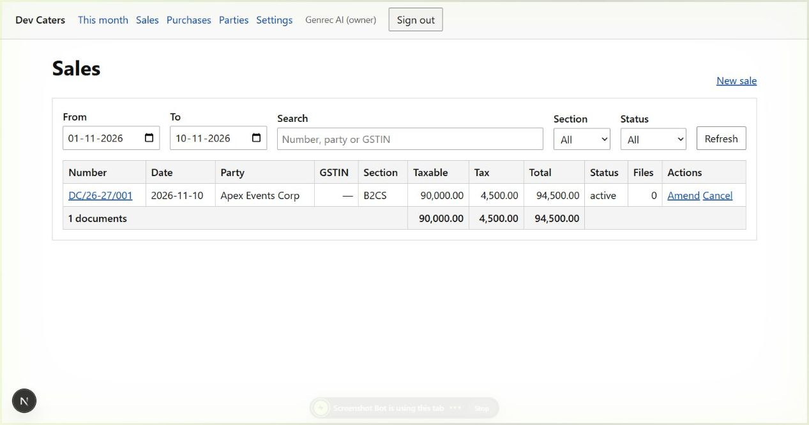

- Filter by date range (`From` - `To`), search query, GST return section (`B2B`, `B2C`, `Export`), or status.
- Summary bar calculates total taxable value, tax collected, and bill totals in real time.

### 6.2 Creating a New Sales Invoice
Click **New invoice** (or **New sale**) at `/sales/new`:

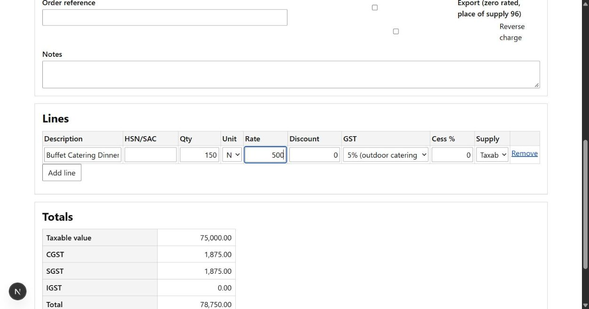

**Step-by-Step Instructions:**
1. **Type:** Choose `Invoice`, `Credit note`, or `Debit note`.
2. **Invoice Number:** Auto-generated based on business prefix and fiscal counter (e.g. `DC/26-27/001`).
3. **Date:** Select the date of supply.
4. **Price Mode:** Choose `GST added` (tax exclusive) or `GST included` (tax inclusive).
5. **Customer:** Type customer name. Registered party address and GSTIN auto-populate.
6. **Place of Supply (POS):** If POS matches your home state (`33`), the engine charges **CGST + SGST**. If POS is outside the state, **IGST** is applied automatically.
7. **Line Items:**
   - **Description:** Item description (e.g. *Buffet Catering Dinner Service*).
   - **HSN:** Applicable code (e.g. *996331*).
   - **Quantity & Unit:** Quantity (e.g. `150`) and UQC (`NOS`, `PLT`, `KGS`).
   - **Rate (₹):** Unit rate in rupees (e.g. `500.00`).
   - **Tax Rate:** Select applicable tax rate (e.g. `5%` or `18%`).
   - Click **Add line** for additional items.
8. **Live Tax Computation:** The right-hand breakdown instantly calculates:
   - Taxable value: `₹75,000.00`
   - CGST (2.5%): `₹1,875.00`
   - SGST (2.5%): `₹1,875.00`
   - Total: `₹78,750.00`
9. Click **Save** to finalize the document.

### 6.3 PDF Invoice Generation & Printing
From the Sales list or invoice view, click **PDF** to download an official tax invoice:
- Includes registered company headers, buyer address, Place of Supply.
- Detailed itemization with HSN codes and individual tax rate buckets.
- Total amount rendered in figures and Indian Rupee words (e.g. *Seventy-Eight Thousand Seven Hundred Fifty Rupees Only*).
- Authorized signature block.

---

## 7. Purchase Bills & Input Tax Credit (ITC)

### 7.1 Purchases List
Navigate to **Purchases** (`/purchases`):

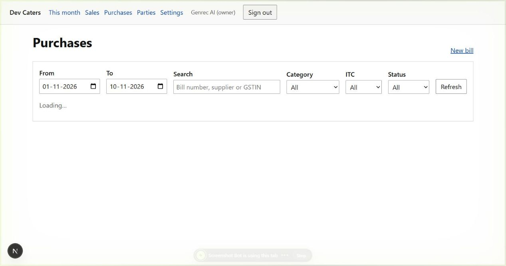

- Lists supplier invoices with invoice number, supplier name, date, category, taxable amount, and eligible ITC.

### 7.2 Recording a New Purchase Bill
Click **New bill** at `/purchases/new`:

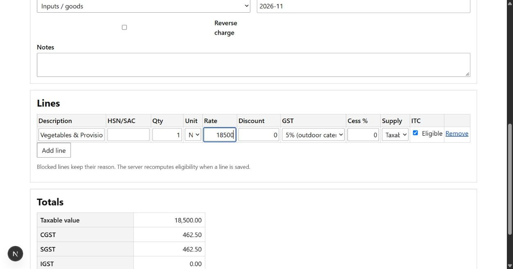

**Step-by-Step Instructions:**
1. **Supplier Bill Number:** Enter vendor's original invoice number (e.g. `INV-SUP-4521`).
2. **Date:** Date printed on the supplier bill.
3. **Supplier:** Select or enter supplier name and GSTIN.
4. **Category:** Choose input category:
   - `Inputs / goods`: Raw vegetables, groceries, spices, cooking oils.
   - `Input services`: Hall rent, cleaning, vehicle transport.
   - `Capital goods`: Commercial kitchen machinery, refrigeration.
   - `Expense (ITC blocked)`: Section 17(5) blocked credits (food & beverages for personal use, motor vehicles).
5. **ITC Period:** Month in which credit is claimed (e.g. `2026-11`).
6. **Line Items:** Add description, quantity, rate, tax rate, and verify the **ITC Eligible** toggle.
7. Click **Save**.

---

## 8. GST Returns & Period Closure (GSTR-1 & GSTR-3B)

The application automatically aggregates transaction data into statutory return formats:

- **GSTR-1 Outward Supplies:**
  - Table 4 (B2B): Invoices issued to GST-registered businesses.
  - Table 5 (B2CL): High-value inter-state consumer invoices (> ₹1,00,000).
  - Table 7 (B2CS): Retail consumer sales.
  - Table 12: HSN Summary of outward supplies.
- **GSTR-3B Tax Summary & Settlement:**
  - Section 3.1: Output tax liability.
  - Section 4: Eligible Input Tax Credit and reversals.
  - Legal tax set-off rules (IGST credit applied first against IGST, then CGST/SGST).
- **Filing & Locking:**
  - Once approved and filed with an ARN, the period is locked to prevent retrospective changes.

---

## 9. Document Attachments & Neon Object Storage

You can attach electronic receipts, bill scans, or signed agreements to any sale or purchase record:
- **Allowed Formats:** PDF, JPEG, PNG (up to 10 MB).
- **Private Storage:** Files are stored in private Neon Object Storage (S3-compatible) with SHA-256 integrity checksums.
- **Secure Access:** Documents are streamed strictly through authenticated application endpoints. Only the business **Owner** has permission to delete attachments.

---

## 10. Audit Trail & System Security

Navigate to **Settings** -> **Audit log** tab to view the immutable activity log:

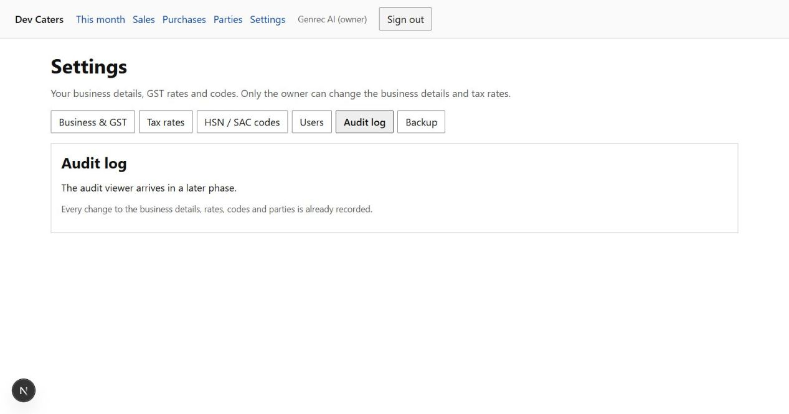

- Every mutation is logged with exact timestamp, user ID, user email, action name, and entity details.
- Maintains JSON snapshots of `before` and `after` states for complete compliance inspection.

---

## 11. Troubleshooting & Frequently Asked Questions (FAQ)

### Q: Why does my sales invoice apply IGST instead of CGST + SGST?
**A:** IGST applies whenever the customer's **Place of Supply (POS)** state code is different from your business home state (`33 Tamil Nadu`). If the customer is located in another state (e.g., Karnataka `29` or Kerala `32`), the system correctly charges IGST.

### Q: Can I edit an invoice in a filed return period?
**A:** No. To ensure tax compliance, locked periods cannot be edited. Instead, issue an **Amendment** (`~A`), or raise a **Credit Note** or **Debit Note** in the current open period.

### Q: What if an attachment upload fails?
**A:** Check that the file is under 10 MB and is a supported format (`PDF`, `JPEG`, or `PNG`).
